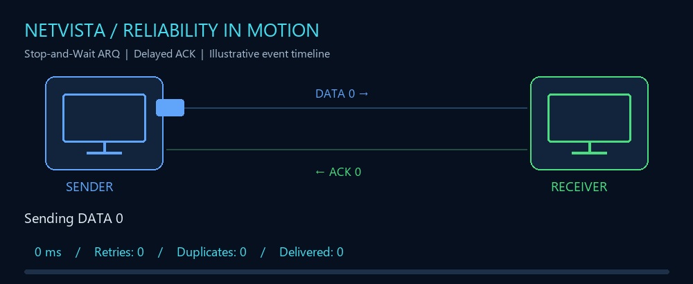
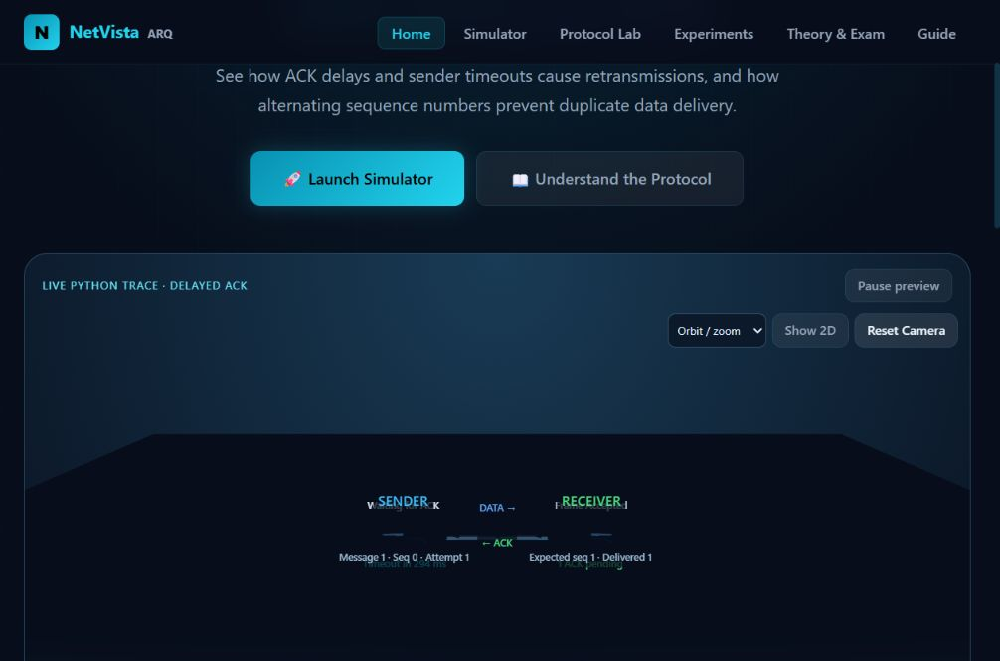
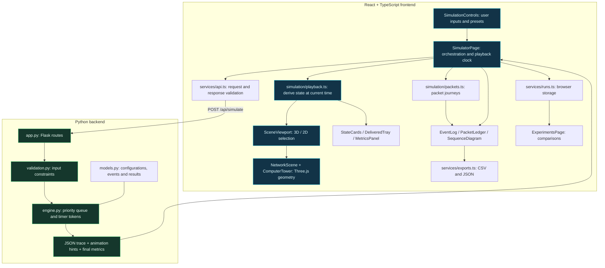
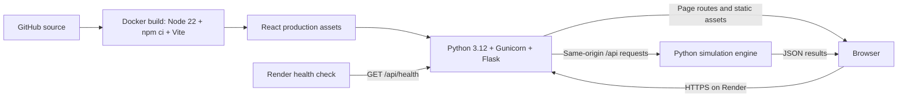

<div align="center">

# 🌐 NetVista ARQ

### Send. Wait. Retry. Understand.

**An interactive 3D networking lab for Stop-and-Wait ARQ with delayed acknowledgments.**

[](netvista-arq/frontend/package.json)
[](netvista-arq/backend)
[](netvista-arq/frontend/src/components/NetworkScene.tsx)
[](https://netvista-arq.onrender.com)

**[🚀 Launch simulator](https://netvista-arq.onrender.com/simulator)** · **[📊 Experiments](https://netvista-arq.onrender.com/experiments)** · **[📖 Theory](https://netvista-arq.onrender.com/theory)** · **[🧭 Guide](https://netvista-arq.onrender.com/guide)**



*Illustrative animation of the reference experiment: one retry, one duplicate discarded, one payload delivered.*

</div>

## Why NetVista?

A late acknowledgment does not mean the original frame was lost. NetVista makes that distinction visible: change the timeout, watch the retry, then inspect how sequence numbers keep the application from receiving the same payload twice.

The website runs an actual Python simulation. Every animation, counter and event time follows the calculated trace.

> **Try it online:** [netvista-arq.onrender.com](https://netvista-arq.onrender.com) — no installation required. The free Render instance may take time to wake after inactivity.

## Inside the lab



| Explore | Observe | Explain |
| --- | --- | --- |
| Rotate, zoom and follow packets | DATA and ACK journeys | One outstanding message at a time |
| Change ACK delay and timeout | Retransmissions and timer resets | Why a delayed ACK causes a retry |
| Pause and step through events | Duplicate detection and delivery counts | Why the payload is delivered only once |
| Compare experiments and export results | Exact send and arrival times | How timeout selection changes results |

## Features

- Detailed 3D workstations, moving packets, orbit/zoom/follow camera controls and a 2D companion view.
- Custom DATA travel time, receiver ACK delay, ACK travel time and sender timeout.
- Alternating sequence bits, retransmissions, duplicate suppression and timeout countdowns.
- Pause, replay, next-event stepping, timeline seeking and playback speeds up to 1000×.
- Packet inspector, event logs, CSV/JSON exports and saved-run comparisons.
- Three reference experiments and worked theory explanations.

## Architecture



Python calculates the complete event trace before playback. React derives visible states and counters from simulation time. Playback speed changes presentation speed, not protocol timings.

### Event engine → playback → evidence

1. **Validate:** the API checks frame count and timing bounds before constructing a simulation configuration.
2. **Schedule:** the engine queues DATA arrivals, ACK sends, ACK arrivals and timeout events by simulation time.
3. **Recover:** a timeout retries the current frame with the same sequence bit. Timer tokens prevent canceled timers from affecting newer transmissions.
4. **Deliver once:** the receiver accepts the expected sequence bit, toggles its expectation and rejects duplicate payloads while acknowledging them again.
5. **Replay:** the frontend derives sender state, receiver state and in-flight packets from the shared clock. Seeking backward reconstructs the earlier state.
6. **Inspect:** live counters track playback; final results remain separately labeled. Packet tables, logs and exports provide evidence for each run.

### Deployment architecture



One web service serves the interface and API. No database or external simulation service is required. Saved comparisons live in the browser; simulation traces are calculated per request.

| Layer | Stack |
| --- | --- |
| Interface | React 18, TypeScript, Vite |
| Visualization | Three.js, React Three Fiber, Drei, Recharts |
| Backend | Python 3.12, Flask |
| Deployment | Docker, Gunicorn, Render |

<details>
<summary><strong>🛠 Developer setup — expand for commands</strong></summary>

## Development setup

```bash
git clone https://github.com/GranthSenjaliya88/CN-Project.git
cd CN-Project/netvista-arq
python -m pip install -r backend/requirements.txt
python backend/app.py
```

The local backend listens on port 5000 and serves the committed frontend build without Node.js. For the hosted website, use the [Render demo](https://netvista-arq.onrender.com).

For frontend development, use Node.js 24+ and a second terminal:

```bash
cd CN-Project/netvista-arq/frontend
npm ci
npm run dev
```

Vite runs on port 3000 and proxies `/api` to Flask on port 5000. Run `npm run build` after frontend edits to refresh the version Flask serves.

</details>

## Reference experiments

All presets use one message and 100 ms each for DATA and ACK travel.

| Scenario | ACK delay | Timeout | First ACK arrival | Retries | Duplicates |
| --- | ---: | ---: | ---: | ---: | ---: |
| Normal delivery | 100 ms | 800 ms | 300 ms | 0 | 0 |
| Delayed ACK | 900 ms | 600 ms | 1100 ms | 1 | 1 |
| Adjusted timeout | 900 ms | 1400 ms | 1100 ms | 0 | 0 |

Each delivers the payload once. **ACK return duration = DATA travel + receiver ACK delay + ACK travel.** Receiver waiting time is separate from ACK travel time.

## API

| Method | Endpoint | Purpose |
| --- | --- | --- |
| GET | `/api/health` | Service health |
| GET | `/api/scenarios` | Presets and expected results |
| POST | `/api/simulate` | Calculate a simulation trace |

```json
{"num_frames":1,"data_travel_ms":100,"ack_delay_ms":900,"ack_travel_ms":100,"timeout_ms":600}
```

## Source layout

```text
netvista-arq/
  backend/app.py       # API and frontend serving
  backend/simulator/  # Engine, models and validation
  backend/tests/
  frontend/src/pages/ # Home, simulator, experiments, theory and guide
  frontend/src/components/ # Scenes, controls, dashboards and tables
  frontend/src/simulation/ # Playback state and packet journeys
  frontend/src/services/   # API, config, saved runs and exports
  frontend/src/types/      # Shared TypeScript simulation contracts
  frontend/tests/
  frontend/dist/      # Production build
  docs/               # Technical and presentation material
  examples/results/   # Experiment evidence
Dockerfile
render.yaml
START_LAB.cmd
```

Root Flask files are a preserved legacy prototype. Use the application in `netvista-arq/`; do not run both backends on the same port.

## Verification

From `netvista-arq/backend`, run `python -m pytest tests -q`. Running there avoids importing the legacy root simulator.

From `netvista-arq/frontend`:

```bash
npm test
npm run lint
npm run build
```

The suites contain 128 backend and 32 frontend tests covering protocol events, validation, duplicate suppression, playback and exports. The build currently reports a size warning for the 3D bundle.

## Model boundaries

- Only Stop-and-Wait ARQ with delayed ACK is implemented.
- One new message is outstanding at a time; retransmitted copies and ACKs may overlap in flight.
- Alternating sequence bits 0 and 1; ACK n acknowledges DATA n.
- Fixed travel times, without loss, corruption, reordering, jitter or separate serialization delay.
- Every received DATA copy schedules an ACK. ACK arrival wins equal-time ties with timeout.
- Up to 20 messages and 3,600,000 ms per timing input; an event budget limits excessive retries.
- Educational simulation, not physical network traffic. The 3D view requires WebGL.

## Deployment and documentation

Docker builds React with Node 22 and serves it with Python 3.12 and Gunicorn. Render checks `/api/health`. Free hosting can take time to wake after inactivity; public-repository deployments may require Manual Deploy.

- [Render deployment](netvista-arq/docs/render-deployment.md)
- [Technical report](netvista-arq/docs/report.md)
- [Presentation outline](netvista-arq/docs/presentation-outline.md)
- [Recording guide](netvista-arq/docs/recording-guide.md)

Keep the Python trace as the source of truth when making changes, and verify the three reference experiments before changing expected results.
